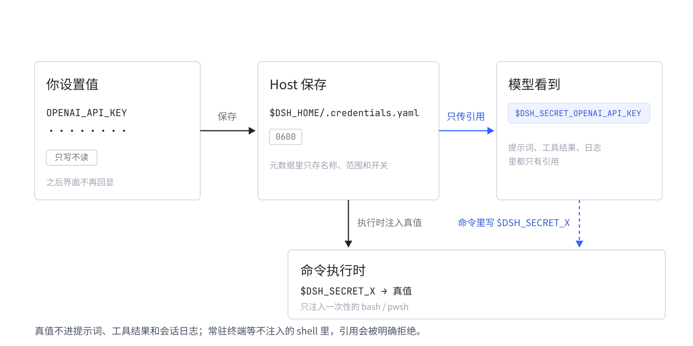
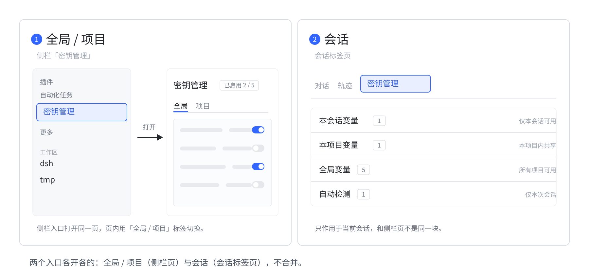
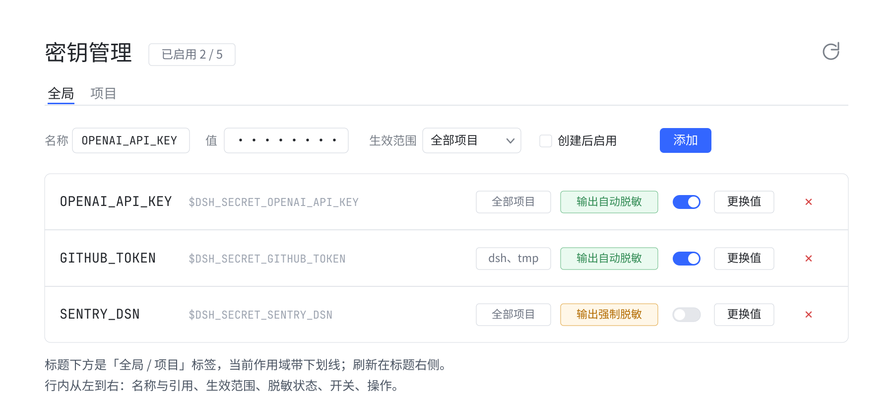
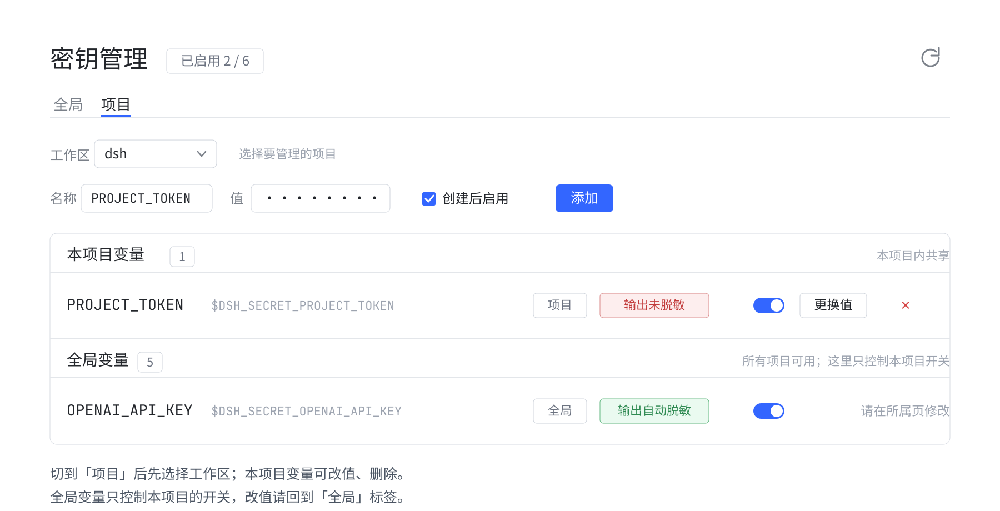
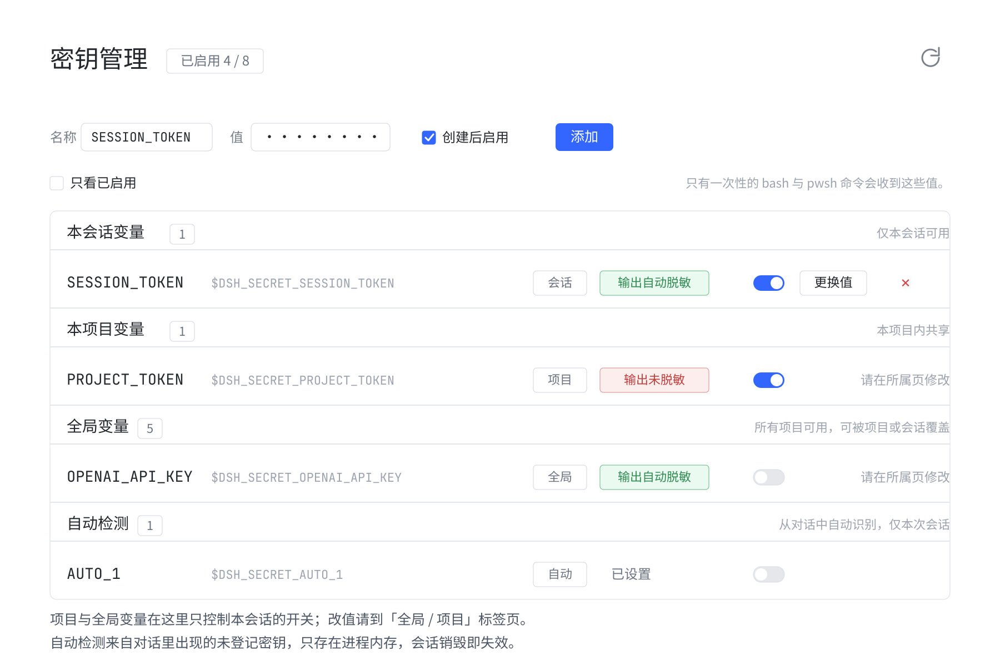

# dsh-secret-variables

[简体中文](README.md) | [English](README.en.md)

DeepSeek Harness 插件：让密钥不出现在模型的上下文里。

你只声明一次变量，模型看到的永远是 `$DSH_SECRET_<NAME>`，真值只在执行一次性 `bash` / `pwsh` 命令时被注入环境变量。值默认不会进入提示词、工具结果、会话日志，也不进插件自己的元数据存储——这个默认以 12 字符为替换下限，更短的值见下面「脱敏」一条。

<a href="docs/images/flow.png"></a>

## 能做什么

- **四个作用域**：全局（全部项目或指定项目）、项目、会话，以及从对话里自动识别的密钥。
- **每行一个开关**：某个全局密钥只在本项目 / 本会话启用，不用改值。
- **值对界面只写不读**：输入后由 Host 凭据接口保存，之后不再显示。
- **脱敏**：工具输出与历史里出现的已知值会替换成引用（短于 12 字符的值仍会注入，默认不参与文本替换；保存这类值时会弹窗提示，可开启「强制脱敏」按 ≥4 字符参与输出替换，注入始终不受影响）。
- **守卫**：常驻终端等不注入值的 shell 里使用引用会被明确拒绝，而不是悄悄展开成空串。

## 界面入口

两个入口，各自独立：侧栏「密钥管理」是**全局 / 项目**入口（页内再切「项目」仍在这个入口里）；会话标签页是**会话**入口，只作用于当前会话。两者不合并；工作区行「⋯」里原来的密钥入口已并入侧栏页。侧栏入口在「自动化任务」下方。

以下配图都是示意图，变量名与数值仅用于展示。

<a href="docs/images/entry.png"></a>

### 全局页

<a href="docs/images/global.png"></a>

全局页与项目页共用标题和标签：标题右侧是刷新，标题下方是 `全局 | 项目` 标签行，当前作用域带下划线。

标题右侧是「已启用 x / y」。添加行依次是名称、值、生效范围、「创建后启用」和「添加」；「创建后启用」默认不勾选，项目页和会话页的同类开关默认勾选。

一行从左到右：

| 部分 | 显示什么 | 例子 |
| --- | --- | --- |
| 名称 / 环境变量 | 模型看到的引用 | `OPENAI_API_KEY` · `$DSH_SECRET_OPENAI_API_KEY` |
| 范围 / 来源 | 全局页显示生效范围，项目页与会话页显示来源 | `全部项目` / `dsh、tmp` / `项目` / `全局` / `自动` |
| 状态 | 已设置并满足脱敏条件时显示脱敏徽标，否则显示 `未设置` | `输出自动脱敏` / `输出强制脱敏` / `输出未脱敏` |
| 开关 | 在该作用域是否启用（自动检测行不可切换） | ● |
| 操作 | 更换值、删除 | `更换值` · `✕` |

生效范围是下拉：默认 **全部项目**，每个项目一个勾选项；勾项目自动取消「全部项目」，取消最后一个自动回退到它。同一作用域重名会被拒绝，不同作用域同名是覆盖机制。

名称会自动归一化：转大写、非字母数字转下划线、去掉首尾下划线、最长 40 字符——`openai-api-key` 与 `OPENAI_API_KEY` 都会得到 `OPENAI_API_KEY`；纯非拉丁文字的名称落为 `SECRET_<8 位哈希>`。环境变量名在前面加 `DSH_SECRET_`。重名按归一化结果判断，所以 `a`、`A`、`a!` 视为同名。

行内徽标（在「状态」列）：`输出自动脱敏` = 值长度 ≥12 且未开强制脱敏，输出里自动替换（绿色）；`输出强制脱敏` = 变量开了强制脱敏且值 ≥4（黄色）；`输出未脱敏` = 值太短，<12 或强制时 <4（红色）。注入始终不受影响。值未设置时这一列显示 `未设置`；`已设置` 只出现在自动检测行——这些条目没有元数据行，界面只能确认值在本次进程内存里。

### 项目页（侧栏「密钥管理」→ 项目）

<a href="docs/images/project.png"></a>

标题下方切到「项目」标签后，页面上方是工作区下拉；选定项目后显示本项目变量与该项目的全局变量。本项目变量可直接改值、删除；全局变量只显示开关和「请在所属页修改」。本项目变量与全局变量同名且两者都启用时，全局那条会标为「被覆盖」。

### 会话页（对话 | 轨迹 | 密钥管理）

<a href="docs/images/session.png"></a>

分组依次是「本会话变量 / 本项目变量 / 全局变量 / 自动检测」，标题右侧带数量和一句说明；没有内容的分组不显示，「自动检测」例外——无命中时会显示触发条件提示。「自动检测」里的 `AUTO_n` 就是从对话里识别出来、只存在本次会话内存里的兜底变量。

同名变量按会话 → 项目 → 全局取最具体的**启用**项；更具体的那条关闭时，会自动落到下一层。已启用但输给更具体启用项的定义会显示为「被覆盖」（置灰、开关不可用），不参与注入和提示词。

添加行下方还有「只看已启用」过滤，只列出本会话里开着的变量。

## 安装（源码）

需要 DSH **>= 0.2.2-rc.1**、Node **>= 20**。只发源码，未发布到 npm。

`package.json` 的 `dsh.bundle.patch` 指向包内的 `cordis.patch.yml`。克隆本仓库，按 bundle 装进 profile：

```sh
dsh plugin --profile web add /path/to/dsh-secret-variables
```

重启 DSH，确认插件管理器里 `@local/dsh-secret-variables` 已启用（直接在插件管理器里安装 bundle 效果相同），侧栏就会出现「密钥管理」。

## 使用

模型写引用，Host 在执行时把值换成环境变量：

```sh
curl -s -H "Authorization: Bearer $DSH_SECRET_OPENAI_API_KEY" https://api.example.com/
```

## 自动检测（兜底）

未登记的密钥在下面三类文本里出现时会被扫描：工具结果、PTC 调度日志、以及进入模型前的消息（包括你发的消息）。命中后替换成 `$DSH_SECRET_AUTO_n`，列在会话页「自动检测」下。

它只按**已知凭证格式**匹配，不做长度或熵值猜测：

| 格式 | 例子 |
| --- | --- |
| PEM 私钥 | `-----BEGIN … PRIVATE KEY-----` |
| URL 内嵌密码 | `user:password@host` |
| OpenAI 风格 key | `sk-…`（`sk-` 后至少 20 位且整体含数字） |
| Google API key | `AIza…` |
| GitHub token / PAT | `ghp_…` / `github_pat_…` |
| GitLab / npm / HuggingFace | `glpat-…` / `npm_…` / `hf_…` |
| AWS / 阿里云 / 腾讯云 | `AKIA…` / `ASIA…` / `LTAI…` / `AKID…` |
| Slack / Stripe / Webhook | `xoxb-…` / `sk_live_…` / `whsec_…` |
| JWT | `eyJ….eyJ….…` |

命中后：

- 每个会话默认最多 16 条（插件配置 `maxAuto` 可设为 1–64）；达到上限后新出现的格式串原样保留，不再替换。
- 只存进程内存：会话销毁或插件重载即消失，不落盘、不写凭据文件。
- 只在一次性的 `bash` / `pwsh` 里注入。没有命中时「自动检测」块也常显，并说明触发条件。

**不会识别**：不属于上表的裸串。例如 `Authorization: Bearer <随机串>` 里那段字符没有前缀或结构特征，不会被自动收编，被命令打印出来时也不会被替换。这类值请手动登记——在会话页添加会话变量，值粘贴进去，之后用 `$DSH_SECRET_<名称>` 引用。

## 作用域与优先级

| 作用域 | 入口 | 生命周期 |
| --- | --- | --- |
| 全局 | 侧栏「密钥管理」→ 全局 | 删除前一直有效，落盘 |
| 项目 | 侧栏「密钥管理」→ 项目 | 删除前一直有效，落盘 |
| 会话 | 会话标签页 | 落盘；会话销毁后不再可用，元数据不会自动清理 |
| 自动 | 对话中识别 | 仅进程内存（每会话默认 ≤16 条） |

按归一化名称（忽略大小写）从会话 → 项目 → 全局解析，取最具体的**启用**项；更具体的那条关闭时自动落到下一层。同一作用域内不允许同名。

## 安全模型

插件防的是**意外泄漏**：已登记的值默认不进提示词、工具结果、日志和接口响应（12 字符下限，见上）。它**不防**有 shell 的 agent 主动提取（例如 `base64 $DSH_SECRET_X`），也不防同用户进程直接读凭据文件。完整「保证 / 不保证」见 [docs/SECURITY.md](docs/SECURITY.md)。

## 开发

```sh
npm install   # 只装测试依赖（React / happy-dom）
npm test
```

139 个测试（Host 逻辑 + UI 冒烟），运行时零依赖，无构建步骤；`client.js` 由 Harness Web 直接加载。只跑 Host 测试可以不装依赖：`node --test test/*.test.js`。见 [CONTRIBUTING.md](CONTRIBUTING.md)。

## 许可证

[MIT](LICENSE)
